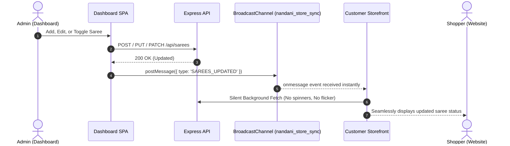

<div align="center">

# 🌸 NANDANI BATIK (නන්දනී බතික්)
### *Luxury Sri Lankan Handcrafted Saree Atelier & Full-Stack E-Commerce Suite*

[](https://react.dev/)
[](https://tailwindcss.com/)
[](https://expressjs.com/)
[](https://supabase.com/)
[](https://vitejs.dev/)
[](#license)

<p align="center">
  A state-of-the-art artisanal e-commerce ecosystem custom-crafted for Sri Lanka's heritage batik textile industry.
  Featuring a high-fashion customer storefront, a real-time admin operations dashboard, and a resilient dual-database Express.js backend.
</p>

[Storefront Features](#-customer-storefront-features) •
[Admin Dashboard](#-admin-operations-dashboard) •
[Quick Start](#-quick-start-guide) •
[Supabase Setup](#-cloud-database-setup-supabase) •
[API Reference](#-rest-api-documentation)

---

</div>

## 📑 Table of Contents
- [🏛️ System Architecture](#️-system-architecture)
- [✨ Core Capabilities](#-core-capabilities)
  - [🛍️ Customer Storefront (`/Website`)](#️-customer-storefront-website)
  - [📊 Operations Dashboard (`/Dashboard`)](#-operations-dashboard-dashboard)
  - [⚙️ Backend REST Engine (`/Backend`)](#️-backend-rest-engine-backend)
- [🛠️ Technology Stack](#️-technology-stack)
- [🚀 Quick Start Guide](#-quick-start-guide)
- [☁️ Cloud Database Setup (Supabase)](#️-cloud-database-setup-supabase)
  - [English Configuration Guide](#english-configuration-guide)
  - [සිංහල උපදෙස් මාලාව (Sinhala Guide)](#සිංහල-උපදෙස්-මාලාව-sinhala-guide)
- [📡 REST API Documentation](#-rest-api-documentation)
- [🔄 Real-Time Cross-Tab Synchronization](#-real-time-cross-tab-synchronization)
- [📦 Production Deployment](#-production-deployment)
- [📄 License & Atelier Heritage](#-license--atelier-heritage)

---

## 🏛️ System Architecture

The Nandani Batik platform is organized as a unified, high-performance monorepo holding three decoupled subsystems:

```text
Nandani-Batik-Website/
├── Backend/                 # Express.js REST API & Supabase Client (Port 5000)
│   ├── data/                # Initial saree seed catalog & local fallback database
│   ├── uploads/             # Static saree photography & local disk asset storage
│   ├── server.js            # Express 5 server: routing, Multer, REST endpoints
│   ├── supabaseClient.js    # Supabase cloud client & Storage CDN uploader
│   ├── supabase_schema.sql  # Production PostgreSQL schema with Row-Level Security
│   └── seed.js              # Database seeder utility
│
├── Dashboard/               # Operations & Inventory Console React SPA (Port 5174)
│   ├── src/
│   │   ├── api/client.js    # Unified REST client with error recovery
│   │   ├── components/      # SareeList, SareeModal, OrderList, Overview KPIs
│   │   └── App.jsx          # Responsive responsive drawer navigation & state sync
│   └── index.html           # Atelier branded operations entry point
│
└── Website/                 # Customer-Facing Boutique Storefront (Port 5173)
    └── src/
        ├── components/      # Luxury CartDrawer, Wishlist, SareeCard, Navbar, Footer
        ├── context/         # CartContext: cart, wishlist, sync, browser routing
        ├── pages/           # HomePage, ShopPage, SareeDetailPage, CheckoutPage, Bridal
        └── index.css        # Tailwind CSS v4 design tokens & bespoke typography
```

---

## ✨ Core Capabilities

### 🛍️ Customer Storefront (`/Website`)
- **Editorial Boutique Layout:** Clean, minimalist, photography-first presentation inspired by international luxury ateliers (Playfair Display serif titles, subtle Sinhala subtitles, warm atelier cream tones `#faf8f5`).
- **Dynamic Saree Catalog (`/shop`):**
  - **Sticky Responsive Filter Sidebar:** Categories, color swatches, and price range filters stay elegantly fixed in view while exploring designs.
  - Zero layout flickering with background silent updates.
- **Dedicated Saree Atelier Page (`/saree/:id`):** Multi-angle portrait galleries, craft specifications, interactive accordions (Craftsmanship, Islandwide Delivery, Wash & Care), and direct WhatsApp Concierge ordering.
- **Dedicated Checkout Page (`/checkout`):**
  - Two-column responsive flow with address inputs, 25 Sri Lankan district selectors, and courier delivery notes.
  - Payment options: **Cash on Delivery (COD)**, **Direct Bank Transfer** (with account details), and **Card/Installments (Koko & Mintpay)**.
  - Instant printable order receipt with one-click **"Confirm Order via WhatsApp"** concierge integration.
- **Bespoke Bag & Wishlist Drawers:** Minimalist slide-over drawers with smooth quantity adjustments and instant item removal.
- **HTML5 History Routing:** Synchronized browser URLs (`/`, `/shop`, `/bridal`, `/about`, `/care`, `/contact`, `/saree/:id`, `/checkout`) supporting native browser Back and Forward navigation.

### 📊 Operations Dashboard (`/Dashboard`)
- **Live Inventory Management:**
  - Create, edit, toggle, and delete saree records with rich metadata (Sinhala name, fabric, primary color, prices, pallu details).
  - Multi-image file uploads via Multer and Supabase Storage CDN.
  - Instant status switches: **In Stock / Out of Stock**, **Bestseller**, and **New Arrival**.
- **Customer Order Pipeline:**
  - Real-time customer order tracking with status lifecycles: `Pending` → `Confirmed` → `Processing` → `Shipped` → `Delivered`.
  - Customer phone, WhatsApp, delivery address, and ordered items breakdown.
  - **One-Click WhatsApp Customer Contact:** Launches pre-formatted WhatsApp chat with the customer including their order reference.
- **Atelier Analytics & KPIs:** Live revenue computation, confirmed order totals, average order value (AOV), and inventory stock ratios.
- **Fully Responsive Drawer:** Optimized for desktop monitors, tablets, and smartphone management on the go.

### ⚙️ Backend REST Engine (`/Backend`)
- **Dual-Database Resilience:** Connects seamlessly to **Supabase Cloud PostgreSQL**. If cloud connectivity is unreachable or offline, it gracefully falls back to a structured local JSON store with zero downtime.
- **Cloud Media Storage:** Direct image upload pipeline to Supabase Storage public buckets with automatic fallback to local disk storage.
- **Cross-Origin Resource Sharing (CORS):** Preconfigured for seamless local and production storefront communication.

---

## 🛠️ Technology Stack

| Layer | Technologies |
| :--- | :--- |
| **Storefront Frontend** | React 19, Vite 8, Tailwind CSS v4, Lucide React Icons |
| **Admin Dashboard** | React 19, Vite 8, Tailwind CSS v4, HTML5 BroadcastChannel API |
| **Backend Engine** | Node.js, Express.js 5, Multer (multipart upload handling), CORS, Dotenv |
| **Cloud Database** | Supabase (PostgreSQL 15), Row-Level Security (RLS), Cloud Storage Buckets |
| **State & Navigation** | React Context API, LocalStorage persistence, HTML5 History API |
| **Typography & Styling** | Playfair Display (Luxury Serif), Plus Jakarta Sans, Custom Batik Watermarks |

---

## 🚀 Quick Start Guide

### Prerequisites
- [Node.js](https://nodejs.org/) (Version 18.x, 20.x, or 24.x recommended)
- `npm` (Version 9.x or higher)

### 1. Clone the Repository
```bash
git clone https://github.com/your-username/Nandani-Batik-Website.git
cd Nandani-Batik-Website
```

### 2. Launch Services (Open 3 Terminals)

#### Terminal 1: Backend API (Port 5000)
```bash
cd Backend
npm install
npm run dev
```
> Server running at: **`http://localhost:5000`**

#### Terminal 2: Operations Dashboard (Port 5174)
```bash
cd Dashboard
npm install
npm run dev
```
> Admin Dashboard running at: **`http://localhost:5174`**

#### Terminal 3: Customer Storefront (Port 5173)
```bash
cd Website
npm install
npm run dev
```
> Customer Storefront running at: **`http://localhost:5173`**

---

## ☁️ Cloud Database Setup (Supabase)

### English Configuration Guide

1. **Create Project:** Visit [supabase.com](https://supabase.com), create a free account, and set up a new project (e.g., `nandani-batik` in `ap-southeast-1 Singapore`).
2. **Execute Database Schema:**
   - In your Supabase project dashboard, navigate to the **SQL Editor**.
   - Open [Backend/supabase_schema.sql](file:///c:/Users/umindu/Desktop/Nandani-Batik-Website/Backend/supabase_schema.sql), copy its complete contents, paste into the SQL Editor, and click **Run**.
   - *(Creates tables `sarees`, `categories`, `orders`, and configures public read / authenticated write RLS policies)*.
3. **Configure Media Storage Bucket:**
   - Navigate to **Storage** → Click **New Bucket**.
   - Name: `saree-images`
   - Enable **Public bucket** → Click **Save**.
4. **Link Credentials:**
   - Go to **Project Settings** (Gear icon) → **API**.
   - Copy your **Project URL** and **`anon` `public` key**.
   - Update `Backend/.env`:
     ```env
     PORT=5000
     SUPABASE_URL=https://your-project-id.supabase.co
     SUPABASE_ANON_KEY=eyJhbGciOiJIUzI1NiIsInR5cCI6IkpXVCJ9...
     ```
5. **Seed Initial Saree Collection:**
   Run the automated database seeder:
   ```bash
   cd Backend
   npm run seed
   ```
   *Seeds all 12 authentic Nandani Batik saree designs and categories.*

---

### සිංහල උපදෙස් මාලාව (Sinhala Guide)

1. **Supabase ගිණුමක් සාදන්න:** [supabase.com](https://supabase.com) වෙත ගොස් නොමිලේ ගිණුමක් සාදා **"New Project"** ක්ලික් කරන්න.
2. **Database Schema එක Run කරන්න:**
   - Supabase හි **SQL Editor** වෙත යන්න.
   - `Backend/supabase_schema.sql` ගොනුවේ ඇති SQL කේතය Paste කර **"Run"** ක්ලික් කරන්න.
3. **Storage Bucket එකක් සාදන්න:**
   - **Storage** වෙත ගොස් **"New Bucket"** ක්ලික් කරන්න.
   - Bucket Name එක ලෙස `saree-images` ලබා දී **Public bucket** යන්න සක්‍රීය (ON) කර Save කරන්න.
4. **API Keys සම්බන්ධ කරන්න:**
   - **Project Settings** → **API** වෙතින් **URL** සහ **`anon` public key** එක Copy කර `Backend/.env` ගොනුවේ ඇතුළත් කරන්න.
5. **සාරි දත්ත ඇතුළත් කරන්න:**
   - Terminal එකේ `cd Backend && npm run seed` run කරන්න. සාරි 12ම ස්වයංක්‍රීයව Database එකට එකතු වේ.

---

## 📡 REST API Documentation

Base URL: `http://localhost:5000/api`

| Method | Endpoint | Description |
| :--- | :--- | :--- |
| `GET` | `/health` | Check backend server & Supabase cloud connection status |
| `GET` | `/stats` | Retrieve aggregate metrics: total sarees, active orders, revenue |
| `GET` | `/sarees` | Fetch sarees list (supports `?category=`, `?inStock=`, `?search=`) |
| `GET` | `/sarees/:id` | Fetch specific saree record by ID |
| `POST` | `/sarees` | Create a new saree record with full specifications |
| `PUT` | `/sarees/:id` | Update an existing saree record |
| `PATCH` | `/sarees/:id` | Toggle specific boolean fields (`inStock`, `isBestseller`, `isNew`) |
| `DELETE` | `/sarees/:id` | Remove a saree from the catalog |
| `GET` | `/categories` | Fetch all atelier saree categories |
| `POST` | `/categories` | Create a new product category |
| `PUT` | `/categories/:id` | Update category title or description |
| `DELETE` | `/categories/:id` | Remove category |
| `GET` | `/orders` | Fetch all customer orders sorted by latest date |
| `POST` | `/orders` | Create a new checkout customer order |
| `PATCH` | `/orders/:id` | Update order status (`pending`, `confirmed`, `shipped`, etc.) |
| `DELETE` | `/orders/:id` | Delete an order record |
| `POST` | `/upload` | Multipart photo upload (saves to Supabase Storage CDN or local disk) |
| `POST` | `/seed` | Populate database with default demo sarees |

---

## 🔄 Real-Time Cross-Tab Synchronization

The Nandani Batik suite features **Zero-Polling Instant Sync** between the Admin Dashboard and Customer Storefront using the **HTML5 `BroadcastChannel` API** and storage event hooks:



- **No flickering:** Background silent synchronization never triggers intrusive loading spinners on active visitors.
- **Deep Comparison:** State references are only refreshed if data actually changed, preventing redundant React re-renders.

---

## 📦 Production Deployment

### Building Static Assets

```bash
# 1. Build Website Production Bundle
cd Website
npm run build

# 2. Build Dashboard Production Bundle
cd ../Dashboard
npm run build
```
Compiled production bundles are output to `Website/dist` and `Dashboard/dist`.

### Recommended Hosting Providers
- **Backend API:** [Railway](https://railway.app), [Render](https://render.com), or [Heroku](https://heroku.com)
- **Storefront & Dashboard:** [Vercel](https://vercel.com) or [Netlify](https://netlify.com)
- **Database & Asset CDN:** [Supabase](https://supabase.com)

---

## 📄 License & Atelier Heritage

Copyright © 2026 **Nandani Batik Atelier**. All rights reserved.

Handcrafted with pride and reverence for the authentic wax-resist textile artisans of Sri Lanka. 🇱🇰
